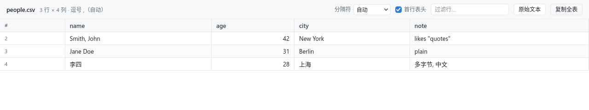
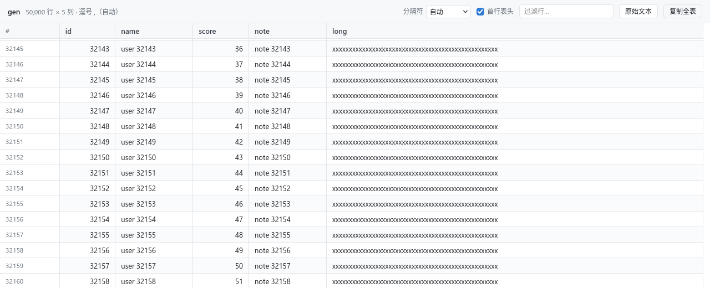
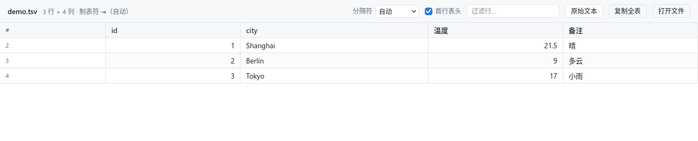
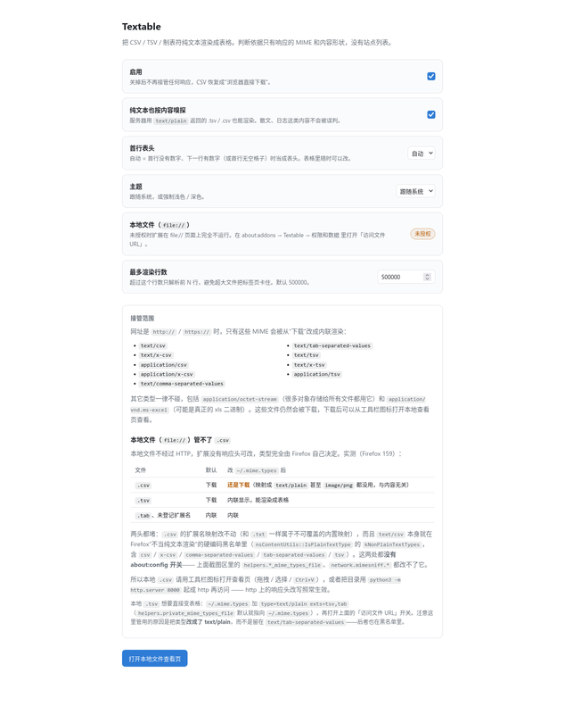

# Textable

Firefox 扩展：把 CSV / TSV 直接显示成表格。点开一个 `.csv` 链接，看到的是可筛选、可虚拟滚动的表格，而不是下载提示。



Firefox 对 `text/csv`、`text/tab-separated-values` 一律下载（实测 159，即使响应头是 `Content-Disposition: inline`），页面上根本没有文档。Textable 在**响应头阶段**把这些类型改写成 `text/plain`，浏览器于是内联渲染，内容脚本再把 `<pre>` 换成表格。

**服务器不需要改，URL 也不会变。** 判断只看响应的 MIME，没有站点列表、不匹配 URL 后缀。

## 功能

- **表格渲染**：粘性表头、行号列、列宽按内容量（滚动时不跳动）、数字右对齐、深浅色跟随系统。
- **虚拟滚动**：只渲染可见的几十行，5 万行、50 万行都不卡。
- **分隔符**：自动嗅探制表符 / 逗号 / 分号 / 竖线，也可以手动指定。
- **表头**：自动判断首行是不是表头，一个勾选框随时改，只影响当前文件。
- **查找 / 过滤**：`Ctrl+F` 直接落到表格自己的过滤框，输入即筛并显示命中数，`Esc` 清空。
  5000 行以内整表进 DOM，浏览器自带的查找、`Ctrl+A` 全选也能用（更大的文件走虚拟滚动）。
- **原始文本**：一键在表格与原文之间切换。
- **复制**：双击单元格复制；「复制全表」导出 TSV（Excel / Numbers 直接吃）。
- **本地文件**：工具栏图标打开查看页，支持拖拽、选择文件、`Ctrl+V` 粘贴，编码可选 自动 / UTF-8 / GBK / Big5 / UTF-16LE。

| 大文件（虚拟滚动） | 本地文件查看页 |
| --- | --- |
|  |  |

## 安装

**从 Releases 安装（推荐）**：下载 `textable-<version>-signed.xpi`，在 Firefox 里打开它，或
`about:addons` → 齿轮 → 「从文件安装附加组件」。这个包已经过 Mozilla 签名，Firefox 128+ 正式版可直接安装。

**开发时临时载入**：

```bash
about:debugging#/runtime/this-firefox → 「临时载入附加组件」 → 选 manifest.json
```

安装后浏览器会要求「访问所有网站」：必须给，否则 `webRequest` 看不到响应头，CSV 会继续下载。
（临时载入的扩展在 Firefox 重启后消失。）

## 支持哪些文件

| 响应头 | 结果 |
| --- | --- |
| `text/csv`、`text/x-csv`、`application/csv`、`application/x-csv`、`text/comma-separated-values` | 内联 → 表格 |
| `text/tab-separated-values`、`text/tsv`、`text/x-tsv`、`application/tsv` | 内联 → 表格 |
| `text/plain` | 本来就能内联；内容确实像表格时才渲染 |
| `application/octet-stream` | 不接管（太多正常二进制用它），仍然下载 |
| `application/vnd.ms-excel` | 不接管（可能是真正的二进制 xls） |

`text/plain` 的"像表格"判定很保守：前若干行里某种分隔符切出来的列数必须一致、至少两行、至少两列。
散文、日志不会被误判；判错了工具栏上切换一下即可。

## 使用

打开任意 CSV / TSV 链接即可。工具栏从左到右：

```
people.csv  3 行 × 4 列 · 逗号 ,（自动）      分隔符 [自动▾]  ☑首行表头  [过滤行…]  [原始文本] [复制全表]
```

- 引号里的逗号、字段内的换行、`""` 转义、CRLF、BOM、Excel 的 `sep=;` 首行，都按 RFC 4180 处理。
- 想下载原文件：右键链接 →「另存为」。扩展只是让浏览器**也**能看。
- 本地文件（`file://`）的情况比较特殊，见下一节。

设置页（`about:addons` → Textable → 选项）：

| 设置 | 默认 | 说明 |
| --- | --- | --- |
| 启用 | 开 | 关掉后不再改写任何响应，CSV 恢复成下载 |
| 纯文本也按内容嗅探 | 开 | 服务器用 `text/plain` 返回的 TSV/CSV 也能渲染 |
| 首行表头 | 自动 | 单个文件里的勾选框不会改这里 |
| 主题 | 跟随系统 | |
| 最多渲染行数 | 500000 | 超过就截断，避免卡死标签页 |



## 本地文件（`file://`）

本地 `.csv` **不受本扩展控制**，也不受系统 MIME 配置控制：Firefox 把它钉在 `text/csv`
（扩展名映射不可覆盖），而 `text/csv` 又不在"可以在浏览器内查看"的类型里，所以一定走下载。
本地 `.tsv` 可以通过 `~/.mime.types` 改成 `text/plain` 让它内联，之后本扩展就能渲染成表格。

推荐做法：

- **看本地 `.csv`**：工具栏图标 → 查看页 → 拖进去 / 选择文件 / `Ctrl+V`。
- **让 `file://` 也能看 `.csv`**：把目录用 `python3 -m http.server 8000` 起成 http 再访问 ——
  http 上的响应头改写照常生效。

完整的判定表、反证实验和代码依据见 [docs/why-local-csv-cannot-render.md](docs/why-local-csv-cannot-render.md)。

## 工作原理

三层，各管一段：

1. **`background.js`**：`webRequest.onHeadersReceived`（`blocking, responseHeaders`，只拦 `main_frame`）
   看到表格 MIME，就把 `content-type` 改成 `text/plain`（保留 `charset`）、把
   `Content-Disposition: attachment` 改成 `inline`，并把原始 MIME 记下来。
2. **`content.js`**：`document_start` 注入，只处理 `document.contentType === 'text/plain'` 的文档。
   先问后台"我原本是什么类型"，再读 `<body><pre>` 的 `textContent`（浏览器已按 charset 解码好的文本，
   不二次请求）。原本是表格 MIME → 一定渲染；原生 `text/plain` → 嗅探认为像表格才渲染。
   等待期间给 `<html>` 挂 `tt-loading` 把 `<pre>` 藏起来，避免"先看到原文再闪成表格"。
3. **`parse.js` / `viewer.js`**：单遍扫描的 RFC 4180 解析器 + `table-layout: fixed` 固定列宽
   （canvas 量前 400 行）+ 只渲染可见窗口的虚拟滚动。所有单元格用 `textContent` 写入，
   数据里的 HTML 永远只是文字。

## 已知限制

- **只支持 Firefox**。Chrome 的 Manifest V3 没有 blocking `webRequest`，「点链接就内联」这条路走不通。
- **`application/octet-stream` 不接管**：很多对象存储给所有文件都回这个类型，按 MIME 无法与二进制区分。
- **本地 `.csv` 仍然下载**（见上一节）。
- **浏览器自带查找只对 5000 行以内的文件有效**：更大的文件是虚拟滚动，窗口外的行不在 DOM 里，
  浏览器找不到它们，所以 `Ctrl+F` 被接管为表格内过滤。
- **单元格不换行**：字段里的换行在单元格里显示成空格，`title` 有完整值，双击可复制。
- **最多 50 万行**：虚拟滚动的总高度靠元素高度撑出来，Firefox 单个元素高度上限约 1789 万 px，
  28px 行高换算约 63 万行，所以设置页把上限卡在 60 万。
- **响应头改写只作用于主文档**：`fetch()` / XHR 拿 CSV 不受影响。扩展更新后需刷新已打开的页面。

## 开发

```bash
make test     # 81 项：解析器 / 嗅探 / 表头判定 / MIME 判定（node，无需浏览器）
make e2e      # 56 项：headless Firefox + 真扩展 + 本地服务器
make check    # 语法检查 + 冒烟测试 + 打包自检
make build    # dist/textable-<version>.{zip,xpi}，可复现（固定时间戳）
make sign     # 提交 AMO 换签名，产出 dist/*-signed.xpi（unlisted 渠道）
make icons    # 重新生成图标
```

`test/e2e.mjs` 用 Firefox 自带的 **Marionette** 协议驱动浏览器，不依赖 web-ext / geckodriver，验证的正是
这个项目赖以成立的几个事实：`text/csv` 被内联而不是下载、引号/换行/CRLF/BOM 解析正确、`text/plain`
的散文不误判、附件头也被内联、5 万行只渲染可见窗口且能滚到第 50001 行、设置页开关真的改变行为。

签名需要 AMO API 凭证（仓库外，`~/.config/data/mozilla-developers-api.txt`，两行：JWT issuer、key），
详见 `tools/amo-sign.py` 的注释。

## 目录结构

```
manifest.json       MV3；Firefox 专用（blocking webRequest）
common.js           MIME 表、默认设置、共享小工具（四端共用）
parse.js            分隔符文本解析 + 分隔符嗅探 + 表头判定（无 DOM，可单测）
viewer.js           表格渲染：工具栏、固定列宽、虚拟滚动、过滤、原文切换
viewer.css          渲染器样式（作为内容脚本 CSS 注入，选择器全部带 tt- 前缀）
content.js          内容脚本：判定「纯文本 → 表格」并替换页面
background.js       webRequest 头改写 + 原始 MIME 记录 + 工具栏图标
viewer/             本地文件查看页（拖拽 / 选择 / 粘贴 + 编码选择）
options/            设置页
docs/               截图与「为什么本地 CSV 救不了」的调查报告
test/               smoke.test.mjs、e2e.mjs、marionette.mjs、fixture/
tools/              pack.py（打包）、amo-sign.py（签名）、make-icons.py（图标）
```

## 许可

MIT，见 [LICENSE](LICENSE)。
